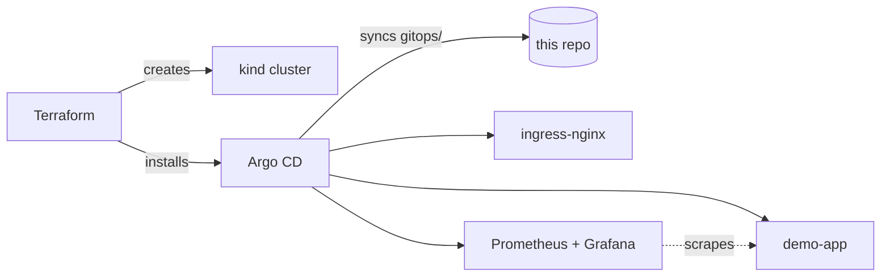

# GitOps Platform

A small Kubernetes platform managed entirely through Git. Terraform creates a local [kind](https://kind.sigs.k8s.io/) cluster and installs Argo CD; Argo CD then deploys ingress, Prometheus, Grafana and a demo app from this repository. Everything runs in Docker, so the only things you need on your machine are Docker and Task.

I built it as a reference for how I set up infrastructure: a clear boundary between Terraform and GitOps, pinned versions, and monitoring that ships with the application.

## How it fits together



Terraform only does what GitOps can't do itself: the cluster, Argo CD and one root Application. Everything inside the cluster lives in `gitops/` and is reconciled by Argo CD. See [docs/decisions](docs/decisions) for the reasoning.

## Prerequisites

| Tool | Requirement |
| :--- | :--- |
| [Docker](https://docs.docker.com/get-docker/) with Compose and [Buildx](https://github.com/docker/buildx) | Required |
| [Task](https://taskfile.dev/installation/) | Required |
| [fzf](https://github.com/junegunn/fzf) | Optional (interactive Task menu) |

Terraform, kubectl, helm, kind and Rust are not needed locally; they run from pinned container images. Plan for roughly 4 GB of free memory for the cluster.

## Getting Started

```bash
git clone git@github.com:robmeijerink/gitops-platform.git
cd gitops-platform
task up
```

`task up` builds the demo image, creates the cluster, installs Argo CD and waits until every Application is Synced and Healthy. The first run takes several minutes while images are pulled.

Then:

```bash
curl http://localhost:8080/          # demo app through the ingress
task argocd:ui                       # https://localhost:8443, user admin
task grafana:ui                      # http://localhost:3000, user admin
curl http://localhost:8080/error     # returns 500; generates data for the error-rate alert
task down                            # destroy everything
```

## Available Commands

Run `task` without arguments for the interactive menu.

| Command | Description |
| :--- | :--- |
| `task up` / `task down` | Create / destroy the whole platform. |
| `task plan` | Show what Terraform would change. |
| <code>task&nbsp;tf&nbsp;&#8209;&#8209;&nbsp;&lt;args&gt;</code> | Run any Terraform command in `infra/environments/local`. |
| <code>task&nbsp;kubectl&nbsp;&#8209;&#8209;&nbsp;&lt;args&gt;</code> | Run any kubectl command against the cluster. |
| `task status` | Argo CD Applications and all pods. |
| `task argocd:ui`, `task grafana:ui` | Port-forward a UI and print the admin password. |
| `task app:check` | Format, Clippy (warnings are errors) and test the demo app. |
| `task app:load` | Build the demo image and load it into the cluster. |
| `task check` | Everything CI runs: `terraform fmt/validate`, tflint, kubeconform, `app:check`. |

## Project Structure

| Path | Description |
| :--- | :--- |
| `infra/modules/` | Terraform modules: `kind-cluster`, `argocd`. |
| `infra/environments/local/` | The environment that wires the modules together. |
| `gitops/bootstrap/` | App-of-apps entry point watched by the root Application. |
| `gitops/platform/` | Platform services as Argo CD Applications (ingress-nginx, kube-prometheus-stack). |
| `gitops/apps/demo-app/` | Kustomize base and local overlay, including ServiceMonitor, alert rules and a Grafana dashboard. |
| `apps/demo-app/` | The demo service (Rust, axum) with `/healthz`, `/readyz` and `/metrics`. |
| `.devcontainer/` | The pinned toolbox image and Compose services every task runs in. |
| `docs/decisions/` | Architecture decision records. |

## Limitations

* Argo CD syncs from `main` on GitHub, not from your working tree. To try a change you have to push it; the end-to-end CI job therefore only runs after a merge.
* The toolbox container mounts the Docker socket (kind needs it). Fine on a dev machine, not something to run on a shared host.
* Terraform state is local. There is no cloud environment, so load balancers, DNS and managed identity are not covered.
* Prometheus and Grafana run without persistent storage, and Alertmanager has no receivers configured.

---

This repository is part of the work of [Solvalutions](https://solvalutions.com) and [Rob Meijerink](https://robmeijerink.nl).
